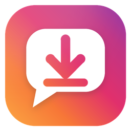

<p align="center"></p>

# InstaDM Saver

A small tool to save your Instagram DMs to a file, right from your terminal. You pick a chat, it grabs the messages and saves them as TXT, JSON or CSV.

Everything is in one file, `instadm_saver.py`. No setup, no requirements file, nothing to configure.

## How to use it

You just need [Python](https://www.python.org/downloads/) 3.9 or newer. On Windows, make sure you tick Add Python to PATH when you install it.

Then double-click `instadm_saver.py` and that's it. You can also run it yourself:

```
python instadm_saver.py
```

The first time you start it, it asks if it can install the two things it needs. That's `instagrapi`, which talks to Instagram, and `rich`, which makes the terminal look good. Say yes and it installs the newest versions for you.

After that it checks for updates every time you open it and installs them by itself. Instagram changes stuff a lot and `instagrapi` usually fixes it fast, so this keeps the login working. No internet? Then it just skips the check and starts with what you already have.

## What it does

You log in with your username and password, and 2FA works too. Your session gets saved so you don't have to log in every time, but your password is never stored anywhere.

Then you see your inbox. Pick a chat by its number or just type part of a username to search. You choose how many messages you want, it shows the last few as chat bubbles, and then you can save everything as a file.

## Login says your Instagram version is out of date

Yeah, that one is annoying. Instagram sometimes blocks password logins from tools like this and shows that message, and honestly it can also just mean your password was wrong.

The fix is to pick Browser cookie when you log in. The app shows you step by step how to copy the `sessionid` cookie from instagram.com in your browser, and that works almost every time. Just treat that cookie like a password, because anyone who has it can get into your account.

## Where your files go

Your saved chats end up in `~/Instagram_DM_Fetcher_Chats`, with a folder for every person. You can change that folder in the menu. Your login session and settings are in `~/.instagram_dm_fetcher`, and if you hit Log out in the menu the saved session gets deleted.

## Disclaimer

This is for personal use. You're the one responsible for following Instagram's Terms of Service, so use it at your own risk.

## License

MIT, see [LICENSE](LICENSE).
